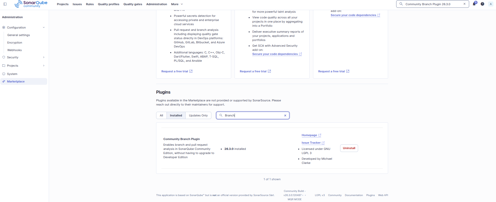
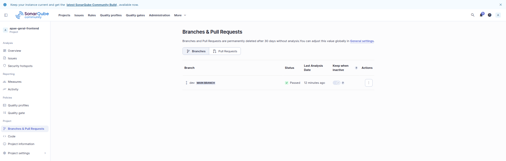
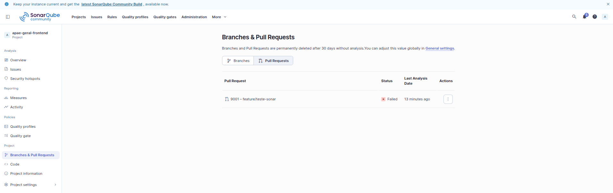
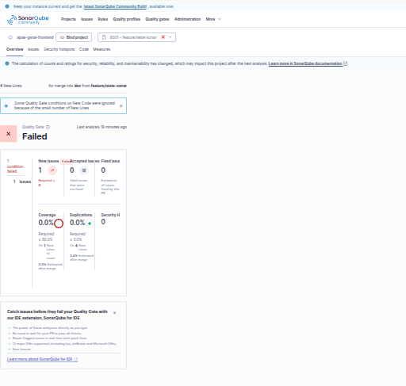

# Execução Local do SonarQube

Este documento fornece as instruções para configurar e executar a análise estática de código com o SonarQube localmente, abrangendo tanto o frontend quanto o backend do repositório Geral da APAE.

## 1. Pré-requisitos

Para rodar a análise, você precisará ter instalados:

* **Docker** (e Docker Compose)
* **JDK 21**

**Nota sobre o Backend:** O projeto utiliza o **Maven Wrapper (`mvnw`)**, portanto **não é necessário ter o Maven instalado** na sua máquina — o wrapper baixa e utiliza a versão correta do Maven automaticamente.

**Nota sobre o Frontend:** O scanner do frontend roda embutido em um container Docker, portanto **não é necessário ter o Node instalado** na sua máquina para esta etapa.

**Configuração do Sistema Operacional (Elasticsearch):**

O SonarQube utiliza o Elasticsearch por baixo dos panos, que exige um limite de áreas de memória virtual mapeadas de pelo menos `262144`.

Verifique o valor atual na sua máquina com o comando:

```
cat /proc/sys/vm/max_map_count
```

Caso o valor retornado seja menor que `262144`, você precisará aumentá-lo (em distribuições Linux, temporariamente com `sudo sysctl -w vm.max_map_count=262144` ou permanentemente editando o arquivo `/etc/sysctl.conf`). A maioria das distribuições já vem com um valor acima disso por padrão.

## 2. Subir o servidor

Para iniciar o SonarQube localmente, utilize o arquivo de composição do repositório executando o comando abaixo a partir da raiz:

```
docker compose -f docker-compose.sonar.yml up
```

*(Rodar sem a flag `-d` fará com que você veja os logs em tempo real).*

> ⚠️ **Aviso sobre containers órfãos:** Durante a inicialização, o Docker pode exibir o alerta `Found orphan containers ([minio_docs_apae apae-postgres])` e sugerir a flag `--remove-orphans`. **Não utilize essa flag**, pois ela derrubaria os containers de banco de dados e armazenamento do compose principal do projeto.

**Aguardando o servidor:** No log, a mensagem `Web Server is operational` aparecerá primeiro, mas você deve aguardar até que a mensagem final **`SonarQube is operational`** seja exibida.

Como o servidor ficará rodando e ocupando este terminal, **abra uma nova aba ou janela de terminal** para executar os passos seguintes.

O painel do SonarQube estará disponível no endereço: <http://localhost:9500>

**Por que a porta não é a 9000 (padrão)?**

Neste repositório principal (APAE Geral), a porta 9000 já está em uso pelo serviço do **MinIO**. A porta 9500 foi escolhida como desvio para que o desenvolvedor possa ter os três servidores (Geral, Atendimento e Gestão Escolar) de pé ao mesmo tempo, além do MinIO, sem conflitos de porta.

## 3. Gerar o token

Para que os scanners consigam enviar os relatórios de código para o servidor, você precisa realizar o primeiro acesso e gerar um token:

### Primeiro login e troca de senha

1. Acesse <http://localhost:9500> e faça login com o usuário e senha padrão: `admin` / `admin`.
2. O SonarQube exigirá **obrigatoriamente a troca de senha** no primeiro acesso:
   * No campo **Old Password**, digite `admin`.
   * Defina uma nova senha que tenha **no mínimo 12 caracteres** e seja diferente de `admin`.
   *(Nota: Caso você execute o comando de limpeza com perda de volumes `down -v` futuramente, a senha voltará ao padrão `admin/admin`)*.

### Gerando o token

1. Após logar com a nova senha, clique no ícone do seu perfil no canto superior direito e vá em **My Account** > **Security** > **Generate Tokens**.
2. Preencha os campos da seguinte forma:
   * **Name:** Dê um nome de sua escolha (ex: `local-token`).
   * **Type:** O campo vem em branco por padrão. Você deve adicionar a preferência para a opção **"Token de usuário"** (User Token), pois é o tipo adequado para este fluxo de análise.
   * **Expires in:** Pode manter o padrão sugerido de 30 dias (ou escolher conforme preferir).
3. Clique em **Generate** e copie o token gerado.

> ⚠️ **Não use o *Project Analysis Token*.** Esse tipo de token só funciona para projetos que já existem no painel. Como esta será a primeira vez que a análise rodará, os projetos ainda não existem e o scanner falhará ao tentar criá-los.

Após gerar o token, exporte-o para a variável de ambiente `SONAR_TOKEN` no seu terminal (na nova aba que você abriu):

```
export SONAR_TOKEN="cole_seu_token_aqui"
```

> ⚠️ **Atenção:** O token deve ir para a variável de ambiente `SONAR_TOKEN` e **nunca** para dentro de um arquivo versionado no repositório.

## 4. Analisar o backend

Como o código do backend Java está contido no módulo `apps/api`, navegue até o diretório correspondente:

```
cd apps/api
```

Com o token na variável de ambiente e o servidor rodando, execute a análise com o Maven Wrapper (`mvnw`), que dispensa a instalação prévia do Maven na máquina:

```
./mvnw clean verify sonar:sonar
```

Após o término da execução com sucesso (`BUILD SUCCESS`), retorne para a raiz do repositório:

```
cd ../..
```

**Por que o `verify` é necessário?**

A fase `verify` no Maven garante a compilação e a execução dos testes. Sem essa fase, a pasta `target/classes` não é criada, e sem os arquivos `.class` compilados, a análise de Java não acontece. O comando `sonar:sonar` sozinho não serve para analisar o projeto.

## 5. Analisar o frontend

Certifique-se de que está na raiz do projeto (`APAE/`) e execute o script preparado:

```
./.scripts/sonar-scan-frontend.sh
```

*(Certifique-se de que a variável `SONAR_TOKEN` continua exportada no ambiente desse terminal).*

**O que o script faz por baixo?**

Ele roda o scanner em container. O script baixa e executa a imagem Docker do `sonar-scanner-cli`, montando o diretório do módulo atual para dentro do container e enviando os dados para a porta 9500 sem exigir Node instalado ou configurações locais complexas na sua máquina.

## 6. Ler o painel

Após os dois comandos finalizarem com sucesso, volte ao navegador em <http://localhost:9500> e clique na aba **Projects** no menu superior (ou acesse diretamente <http://localhost:9500/projects>).

Você verá as duas chaves de projeto criadas listadas em cards:

* `apae-geral-backend`
* `apae-geral-frontend`

Ao clicar em qualquer um deles, você verá as abas de navegação:

* A aba principal exibe o **Quality Gate**, onde fica o número que interessa em cada uma das métricas (Bugs, Vulnerabilidades, Code Smells, Cobertura, etc).
* A aba **Issues** lista os detalhes específicos de cada problema encontrado no código analisado.

**Significado de cada categoria de problema apontada no SonarQube:**

* **Security:** Vulnerabilidades de segurança, ou seja, pontos onde o código está exposto a riscos concretos de exploração (ex: injeção, exposição de dados sensíveis).
* **Reliability:** Confiabilidade e Bugs, apontando trechos que podem causar comportamentos inesperados ou falhas em tempo de execução.
* **Maintainability:** Manutenibilidade, incluindo Code Smells e a dívida técnica acumulada, ou seja, trechos que dificultam a evolução do código no futuro.
* **Security Hotspot:** Pontos de atenção de segurança que exigem revisão manual, pois o SonarQube identifica um padrão potencialmente arriscado que pode ou não se configurar como vulnerabilidade real.
* **Duplications:** Porcentagem de código duplicado, indicando blocos repetidos que poderiam ser refatorados e reutilizados.

## 7. Cobertura

Atualmente, é esperado que a cobertura de código apareça baixa ou zerada:

* **Backend (`apae-geral-backend`):** O relatório de cobertura (`jacoco.xml`) é gerado durante a fase `verify` do Maven. A porcentagem reportada reflete o volume de testes unitários atualmente implementados no backend.
* **Frontend (`apae-geral-frontend`):** O arquivo de configuração `sonar-project.properties` do módulo espera o relatório de testes no caminho `coverage/lcov.info`. Como os runners de testes do frontend ainda não estão configurados para gerar esse arquivo durante o fluxo local, a cobertura aparece como 0.0%.

Isso deve ser lido como uma etapa futura de implementação das suítes de testes nos repositórios, e **não como um erro de configuração** do seu ambiente local do SonarQube.

## 8. Encerrar e limpar

Quando finalizar seu trabalho e quiser derrubar o container, você tem duas opções:

Para derrubar o container mantendo o histórico de análises salvo para a próxima vez:

```
docker compose -f docker-compose.sonar.yml down
```

Para derrubar e **apagar os volumes e o histórico**:

```
docker compose -f docker-compose.sonar.yml down -v
```

> ⚠️ O segundo comando (com o `-v`) apaga os volumes do banco de dados e Elasticsearch. Isso apagará todo o histórico de análises e **resetará a senha do admin de volta para o padrão `admin/admin`**. Use apenas se precisar limpar configurações corrompidas e recomeçar do zero.

## 9. Análise de branch e pull request

A edição Community analisa um único branch por projeto e não analisa pull request. Com o [sonarqube-community-branch-plugin](https://github.com/mc1arke/sonarqube-community-branch-plugin), o servidor passa a usar a `dev` como base e a analisar cada PR para a `dev` como código novo.

> **Escopo:** implementação inicial. O servidor com o plugin foi configurado e testado localmente. O pipeline está descrito abaixo e será criado numa próxima etapa, nos três repositórios.

### Servidor

| Item | Versão |
|---|---|
| Imagem | `mc1arke/sonarqube-with-community-branch-plugin:26.3.0.120487-community` |
| Servidor | 26.3.0.120487 |
| Plugin | 26.3.0 |

* A imagem já traz o jar do plugin e o `-javaagent`. Por isso o compose **não monta volume em `/opt/sonarqube/extensions`**: um volume existente esconderia o jar, e o servidor não subiria.
* ⚠️ **Restrição de atualização:** o plugin acompanha a versão do servidor. Só dá para atualizar o SonarQube para uma versão que tenha imagem do plugin (a última é a 26.5.0, de junho de 2026). Confira as [tags](https://hub.docker.com/r/mc1arke/sonarqube-with-community-branch-plugin/tags) antes de trocar.

### Configurar

1. Suba o servidor (seção 2) e troque a senha do `admin` no primeiro login. O SonarQube exige login por padrão (`sonar.forceAuthentication`, ligado desde a versão 8.6).
2. Crie os projetos com `dev` como branch principal, com um token do `admin`:
   ```
   for p in apae-geral-backend apae-geral-frontend; do
     curl -u "$SONAR_TOKEN:" -X POST "$SONAR_HOST_URL/api/projects/create" \
       -d project=$p -d name=$p -d mainBranch=dev
   done
   ```
   Se o projeto já existir com o branch `main`, renomeie: `api/project_branches/rename` com `-d project=<projeto> -d name=dev`.
3. **Código novo:** nos PRs, é sempre a diferença contra a `dev`. Na própria `dev`, os seis projetos usam o padrão *Previous version*. Como o pipeline não define `sonar.projectVersion`, isso equivale a tudo desde a primeira análise. Para um recorte menor, use *Number of days* em **Project Settings > New Code**.

### Como vai funcionar o pipeline

* **Push na `dev`:** análise com `-Dsonar.branch.name=dev`, que atualiza a base.
* **PR para a `dev`:** análise com `sonar.pullrequest.key`, `sonar.pullrequest.branch` e `sonar.pullrequest.base=dev`. O PR aparece na aba **Pull Requests** do projeto.
* Nos dois casos, `-Dsonar.qualitygate.wait=true`: **o job falha quando o gate reprova**, e o workflow comenta no PR o resultado e o link da análise. Quem abriu o PR corrige e faz push, sem ninguém precisar rodar o SonarQube na mão.

Para implantar:

1. **Runner self-hosted** na máquina do servidor (**Settings > Actions > Runners**, label `sonar-local`). Os runners do GitHub não alcançam o `localhost` dessa máquina; o runner local busca os jobs no GitHub e fala com o SonarQube ali mesmo. Rode-o com um usuário comum e exija aprovação para PRs de contribuidores externos (**Settings > Actions > General**).
2. **Secrets e variável** em **Settings > Secrets and variables > Actions**. Nada disso vai para arquivo versionado.

   | Aba | Nome | Valor | Lido no workflow como |
   |---|---|---|---|
   | *Secrets* | `SONAR_HOST_URL` | Endereço do servidor | `secrets.SONAR_HOST_URL` |
   | *Secrets* | `SONAR_TOKEN` | Token de um usuário `ci-github` com **Execute Analysis** | `secrets.SONAR_TOKEN` |
   | *Variables* | `SONAR_RUNS_ON` | `sonar-local` | `vars.SONAR_RUNS_ON` |

3. **Bloqueio do merge:** regra da `dev` em **Settings > Branches** exigindo os checks `Análise SonarQube do back-end` e `Análise SonarQube do front-end`.
4. **Workflow** em `.github/workflows/sonarqube.yml` (abaixo). No APAE-atendimento, os caminhos são `backend/atendimento` e `frontend/atendimento-app`, com `verify -DskipTests` porque os testes precisam de PostgreSQL. No APAE-gestao-escolar, `api` e `app`. Esses dois repositórios ainda usam a 26.9, que não tem plugin: troque a imagem para a da tabela acima e apague o volume local (`down -v`), porque o SonarQube não volta de versão.

<details>
<summary>Workflow proposto (<code>.github/workflows/sonarqube.yml</code>)</summary>

```yaml
name: SonarQube

# Push na dev atualiza a análise do branch dev (a base de comparação).
# PR para a dev é analisado como pull request, com o código novo calculado contra a dev.
# O job falha quando o quality gate falha (sonar.qualitygate.wait=true).
on:
  push:
    branches:
      - dev
  pull_request:
    branches:
      - dev

permissions:
  contents: read
  pull-requests: write # comentário com o link da análise

concurrency:
  group: ${{ github.workflow }}-${{ github.ref }}
  cancel-in-progress: true

jobs:
  backend:
    name: Análise SonarQube do back-end
    # Com a variável SONAR_RUNS_ON=sonar-local o job vai para o runner self-hosted
    # instalado na máquina do SonarQube local. Sem ela, usa o runner do GitHub.
    runs-on: ${{ vars.SONAR_RUNS_ON || 'ubuntu-latest' }}
    # PRs vindos de forks não recebem os secrets do repositório.
    if: github.event_name == 'push' || github.event.pull_request.head.repo.full_name == github.repository
    env:
      SONAR_TOKEN: ${{ secrets.SONAR_TOKEN }}
      SONAR_HOST_URL: ${{ secrets.SONAR_HOST_URL }}
    defaults:
      run:
        working-directory: apps/api
    steps:
      - uses: actions/checkout@11d5960a326750d5838078e36cf38b85af677262 # v4
        with:
          fetch-depth: 0

      - name: Verificar secrets do SonarQube
        run: |
          if [ -z "$SONAR_TOKEN" ] || [ -z "$SONAR_HOST_URL" ]; then
            echo "::error::Defina os secrets SONAR_TOKEN e SONAR_HOST_URL no repositório."
            exit 1
          fi

      - name: Definir parâmetros de branch ou pull request
        env:
          EVENT_NAME: ${{ github.event_name }}
          PR_NUMBER: ${{ github.event.pull_request.number }}
          PR_BRANCH: ${{ github.head_ref }}
          PR_BASE: ${{ github.base_ref }}
          BRANCH_NAME: ${{ github.ref_name }}
        run: |
          if [ "$EVENT_NAME" = "pull_request" ]; then
            echo "SONAR_ARGS=-Dsonar.pullrequest.key=$PR_NUMBER -Dsonar.pullrequest.branch=$PR_BRANCH -Dsonar.pullrequest.base=$PR_BASE" >> "$GITHUB_ENV"
          else
            echo "SONAR_ARGS=-Dsonar.branch.name=$BRANCH_NAME" >> "$GITHUB_ENV"
          fi

      - name: Configurar JDK 21
        uses: actions/setup-java@cf277c60eb25467037889841efdb72551f06f6c3 # v4
        with:
          java-version: "21"
          distribution: "temurin"
          cache: maven

      - name: Analisar o back-end
        id: scan
        run: |
          chmod +x mvnw
          ./mvnw -B verify sonar:sonar \
            -Dsonar.host.url="$SONAR_HOST_URL" \
            -Dsonar.qualitygate.wait=true \
            $SONAR_ARGS

      # Devolve o resultado: resumo no job e comentário no PR com o link da análise.
      - name: Publicar resultado da análise
        if: always() && steps.scan.outcome != 'skipped'
        uses: actions/github-script@f28e40c7f34bde8b3046d885e986cb6290c5673b # v7.1.0
        env:
          SONAR_PART: back-end
          REPORT_TASK: apps/api/target/sonar/report-task.txt
          SCAN_OUTCOME: ${{ steps.scan.outcome }}
        with:
          script: |
            const fs = require('fs');
            const file = `${process.env.GITHUB_WORKSPACE}/${process.env.REPORT_TASK}`;
            let url = '';
            if (fs.existsSync(file)) {
              const m = fs.readFileSync(file, 'utf8').match(/^dashboardUrl=(.+)$/m);
              if (m) url = m[1].trim();
            }
            let status;
            if (process.env.SCAN_OUTCOME === 'success') status = '✅ Quality gate aprovado.';
            else if (url) status = '❌ Quality gate reprovado. Corrija os problemas apontados e faça push de novo.';
            else status = '⚠️ A análise falhou antes de chegar ao SonarQube. Veja o log do job.';
            const link = url ? `[Abrir a análise no SonarQube](${url})` : '';
            const marker = `<!-- sonarqube:${process.env.SONAR_PART} -->`;
            const body = [marker, `### SonarQube: ${process.env.SONAR_PART}`, '', status, '', link].join('\n');
            await core.summary.addRaw(body).write();
            if (context.eventName !== 'pull_request') return;
            const { owner, repo } = context.repo;
            const issue_number = context.payload.pull_request.number;
            const comments = await github.paginate(github.rest.issues.listComments, { owner, repo, issue_number, per_page: 100 });
            const old = comments.find((c) => c.body && c.body.includes(marker));
            if (old) await github.rest.issues.updateComment({ owner, repo, comment_id: old.id, body });
            else await github.rest.issues.createComment({ owner, repo, issue_number, body });

  frontend:
    name: Análise SonarQube do front-end
    # Com a variável SONAR_RUNS_ON=sonar-local o job vai para o runner self-hosted
    # instalado na máquina do SonarQube local. Sem ela, usa o runner do GitHub.
    runs-on: ${{ vars.SONAR_RUNS_ON || 'ubuntu-latest' }}
    # PRs vindos de forks não recebem os secrets do repositório.
    if: github.event_name == 'push' || github.event.pull_request.head.repo.full_name == github.repository
    env:
      SONAR_TOKEN: ${{ secrets.SONAR_TOKEN }}
      SONAR_HOST_URL: ${{ secrets.SONAR_HOST_URL }}
    steps:
      - uses: actions/checkout@11d5960a326750d5838078e36cf38b85af677262 # v4
        with:
          fetch-depth: 0

      - name: Verificar secrets do SonarQube
        run: |
          if [ -z "$SONAR_TOKEN" ] || [ -z "$SONAR_HOST_URL" ]; then
            echo "::error::Defina os secrets SONAR_TOKEN e SONAR_HOST_URL no repositório."
            exit 1
          fi

      - name: Definir parâmetros de branch ou pull request
        env:
          EVENT_NAME: ${{ github.event_name }}
          PR_NUMBER: ${{ github.event.pull_request.number }}
          PR_BRANCH: ${{ github.head_ref }}
          PR_BASE: ${{ github.base_ref }}
          BRANCH_NAME: ${{ github.ref_name }}
        run: |
          if [ "$EVENT_NAME" = "pull_request" ]; then
            echo "SONAR_ARGS=-Dsonar.pullrequest.key=$PR_NUMBER -Dsonar.pullrequest.branch=$PR_BRANCH -Dsonar.pullrequest.base=$PR_BASE" >> "$GITHUB_ENV"
          else
            echo "SONAR_ARGS=-Dsonar.branch.name=$BRANCH_NAME" >> "$GITHUB_ENV"
          fi

      - name: Analisar o front-end
        id: scan
        uses: SonarSource/sonarqube-scan-action@4d1dc0c91ee400dcf8a6dddf2f705ac36542e304 # v8.4.0
        with:
          projectBaseDir: apps/apae
          args: >
            -Dsonar.qualitygate.wait=true
            ${{ env.SONAR_ARGS }}

      # Devolve o resultado: resumo no job e comentário no PR com o link da análise.
      - name: Publicar resultado da análise
        if: always() && steps.scan.outcome != 'skipped'
        uses: actions/github-script@f28e40c7f34bde8b3046d885e986cb6290c5673b # v7.1.0
        env:
          SONAR_PART: front-end
          REPORT_TASK: apps/apae/.scannerwork/report-task.txt
          SCAN_OUTCOME: ${{ steps.scan.outcome }}
        with:
          script: |
            const fs = require('fs');
            const file = `${process.env.GITHUB_WORKSPACE}/${process.env.REPORT_TASK}`;
            let url = '';
            if (fs.existsSync(file)) {
              const m = fs.readFileSync(file, 'utf8').match(/^dashboardUrl=(.+)$/m);
              if (m) url = m[1].trim();
            }
            let status;
            if (process.env.SCAN_OUTCOME === 'success') status = '✅ Quality gate aprovado.';
            else if (url) status = '❌ Quality gate reprovado. Corrija os problemas apontados e faça push de novo.';
            else status = '⚠️ A análise falhou antes de chegar ao SonarQube. Veja o log do job.';
            const link = url ? `[Abrir a análise no SonarQube](${url})` : '';
            const marker = `<!-- sonarqube:${process.env.SONAR_PART} -->`;
            const body = [marker, `### SonarQube: ${process.env.SONAR_PART}`, '', status, '', link].join('\n');
            await core.summary.addRaw(body).write();
            if (context.eventName !== 'pull_request') return;
            const { owner, repo } = context.repo;
            const issue_number = context.payload.pull_request.number;
            const comments = await github.paginate(github.rest.issues.listComments, { owner, repo, issue_number, per_page: 100 });
            const old = comments.find((c) => c.body && c.body.includes(marker));
            if (old) await github.rest.issues.updateComment({ owner, repo, comment_id: old.id, body });
            else await github.rest.issues.createComment({ owner, repo, issue_number, body });
```

</details>

### Branch e PR de outro dev

* Branch e PR não pertencem a um usuário: o PR é identificado pelo número e o branch pelo nome.
* Quem envia a análise é o dono do token. No pipeline é sempre o `ci-github`, seja qual for o autor do PR.
* O outro dev só precisa de login no SonarQube para abrir o link da análise.

Para simular sem o pipeline, crie um usuário com **Execute Analysis**, gere um token para ele e, num branch com uma alteração, rode a análise como PR (exemplo do back-end, em `apps/api`):

```
export SONAR_TOKEN="token-do-outro-dev"
./mvnw clean verify sonar:sonar -Dsonar.qualitygate.wait=true \
  -Dsonar.pullrequest.key=9001 -Dsonar.pullrequest.branch=feature/teste-sonar -Dsonar.pullrequest.base=dev
```

Use um número que não seja de PR real e apague o PR depois em **Project Settings > Branches and Pull Requests**.

### Evidências do teste

Teste feito no servidor local, com o projeto `apae-geral-frontend`: a base `dev` enviada pelo `admin` e um PR enviado por um usuário `dev-simulado`, com um problema de propósito (`[...nomes].sort()` sem função de comparação).

| Verificação | Resultado |
|---|---|
| Plugin carregado | ✅ Listado no Marketplace, versão 26.3.0 |
| Seis projetos com `dev` como branch principal | ✅ |
| Análise com `sonar.branch.name=dev` | ✅ Aceita sem erro de edição; gate aprovado |
| PR `9001` na aba Pull Requests, com base `dev` | ✅ |
| Código novo calculado contra a `dev` | ✅ 4 linhas novas e só a issue introduzida pelo PR |
| Gate reprovado trava a análise | ✅ `QUALITY GATE STATUS: FAILED` e saída 3, que deixa o job vermelho |
| Link da análise devolvido | ✅ `.../dashboard?id=apae-geral-frontend&pullRequest=9001` |

> O *Sonar way* também exige 80% de cobertura no código novo. No teste, essa condição foi ignorada porque o PR tinha menos de 20 linhas novas. Em PRs maiores, a cobertura atual de 0% do front-end reprova o gate. As condições ficam para as issues de quality gate.

Plugin instalado, com a versão do servidor no rodapé:



`dev` como branch principal:



PR do outro dev analisado:



Painel do PR com o gate reprovado:


